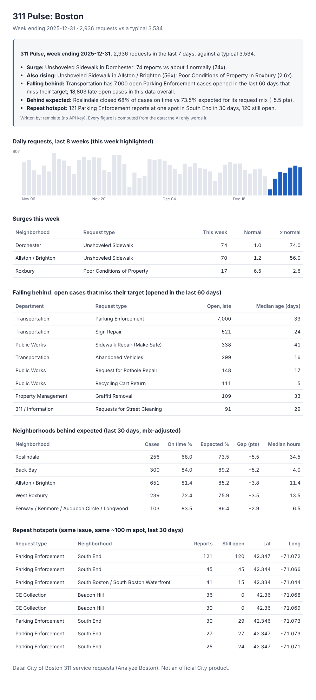

# 311 Pulse: Boston

[](https://github.com/SumanBadakada/boston-311-pulse/actions/workflows/tests.yml)

**A daily-refreshed operations brief for Boston city managers, built from live 311 service requests.** It answers four questions every Monday: *what's surging, who's falling behind, which neighborhoods are being served worse than they should be, and which problems keep coming back.* An AI writes the summary; every number in it is computed from the data and checked before it's shown.

**Today's brief: [sumanbadakada.github.io/boston-311-pulse](https://sumanbadakada.github.io/boston-311-pulse/)** · refreshed every morning from live city data  
**Interactive app: [boston-311-pulse.streamlit.app](https://boston-311-pulse.streamlit.app/)**



## Why

Boston logs hundreds of thousands of 311 requests a year. Dashboards show what happened; a manager starting the week needs to know what to act on. This started as a team Tableau analysis for *Analytics for Managers* at BU Questrom, comparing each neighborhood's on-time rate with what its request mix predicts. 311 Pulse turns that one-off analysis into a tool that runs on any week and says what changed.

## What it finds

| Check | How | Example (week ending Dec 31 2025) |
| --- | --- | --- |
| **Surges** | Last 7 days vs the prior 4 weeks for every neighborhood × request type, ranked by a Poisson z-score so 40→120 outranks 2→6 | Unshoveled Sidewalk in Dorchester: 74 reports vs ~1 normally (a snowstorm) |
| **Falling behind** | Cases open on the chosen date that miss their service target, opened in the last 60 days, by department | Transportation: 7,000 late open Parking Enforcement cases |
| **Behind expected** | The team's mix-adjusted gap: on-time rate minus the citywide rate for the same request types, last 30 days | Roslindale: 68.0% on time vs 73.5% expected (−5.5 pts) |
| **Repeat hotspots** | Same request type at the same ~100 m spot, 30 days | 121 Parking Enforcement reports at one South End spot, 120 still open |
| **Data check** | Request types that nearly vanished citywide | Flags types moved to Boston's new 311 system, so a data change isn't read as fewer problems |

## Live data, refreshed every morning

A GitHub Actions job runs at about 7am Boston time. It pulls the last six weeks of requests from the City's open data API, builds the brief, publishes it to GitHub Pages, and saves the data for the Streamlit app.

Boston is mid-way through moving 311 to a new system, so recent cases live in **two datasets with different columns**. `pulse/live.py` queries both, maps them onto one schema (UTC timestamps converted to Boston time, new-system department and neighborhood names folded into the legacy groupings), and computes each request type's expected on-time rate over the past year with a server-side SQL aggregate instead of downloading a year of rows. The *data check* section exists because of this transition: it flags types that vanish from the data, which usually means a type moved systems, not that the problem went away.

## Keeping the AI honest

The AI never computes. `pulse/engine.py` produces every figure with pandas. `pulse/writer.py` sends only those facts to the model (Gemini's free tier by default, or Claude), then extracts every number from the draft and checks it against the facts. **If any number can't be traced, the draft is thrown away** and a deterministic template brief is used instead. The same check guards follow-up questions in the app. Without an API key the template writer runs, so the tool always works.

## Run it

```bash
pip install -r requirements.txt

python -m pulse.live                           # pull the last 6 weeks of live data
python -m pulse --data data/live_311.csv.gz    # HTML brief for the latest full week
streamlit run app.py                           # interactive: pick a week, map, follow-up questions

export GEMINI_API_KEY=...                      # optional, free tier: AI-written brief and Q&A
```

Without a key everything works and the summary uses the built-in template. `data/sample_311.csv.gz` (68K requests, Sept to Dec 2025, from the course dataset) is the fallback when no live file exists.

## Hosting

- **Daily brief:** GitHub Pages, published by `.github/workflows/daily.yml`. Add `GEMINI_API_KEY` under *Settings → Secrets → Actions* for the AI summary.
- **Interactive app:** Streamlit Community Cloud from this repo's `app.py`, with `GEMINI_API_KEY` in the app's Secrets. Follow-up questions are capped per visitor to protect the free quota.

## How it's built

```
pulse/live.py     pulls both live Boston 311 datasets into one schema
pulse/engine.py   surges, overdue, behind-expected, hotspots, data check (pure pandas)
pulse/writer.py   template brief, Claude brief + number check, follow-up Q&A
pulse/report.py   self-contained HTML brief (inline SVG chart, light/dark)
app.py            Streamlit UI
tests/            offline tests on synthetic data with known answers
```

Design choices worth noting:
- **"As of" any date.** The data stores today's status, so a case closed after the chosen date is treated as still open on it (close time = open time + resolution hours). Any past week can be replayed exactly as it looked then.
- **Actionable over exhaustive.** Overdue cases older than 60 days are counted but not ranked; a 300-day-old open case is a records question, a 3-week-old one can still be worked.
- **A type with no history is not a surge.** New or renamed request codes are excluded from surges rather than flagged at "∞x normal".

## Data and limits

City of Boston [311 Service Requests](https://data.boston.gov/dataset/311-service-requests). The 2024–2025 sample comes from the cleaned course dataset. `expected_on_time` is the citywide on-time rate for each request type. `on_time_flag` is the city's on-time status for each case, so "falling behind" lists open cases already past target or closed late.

Mapping the new system onto the legacy schema is an approximation: department names are matched by code, finer new-system neighborhoods are folded into legacy groupings, and administrative closures (duplicates, invalid, referred) are detected from the closure reason text.

## Roadmap

- Email the brief every Monday (GitHub Actions)
- Department-level views and week-over-week trend for each flagged item

---

Built by [Suman Somaiah](https://github.com/SumanBadakada), extending a team project from *Analytics for Managers* (BU Questrom), with AI pair-programming (Claude). Not an official City of Boston product. MIT licensed.
