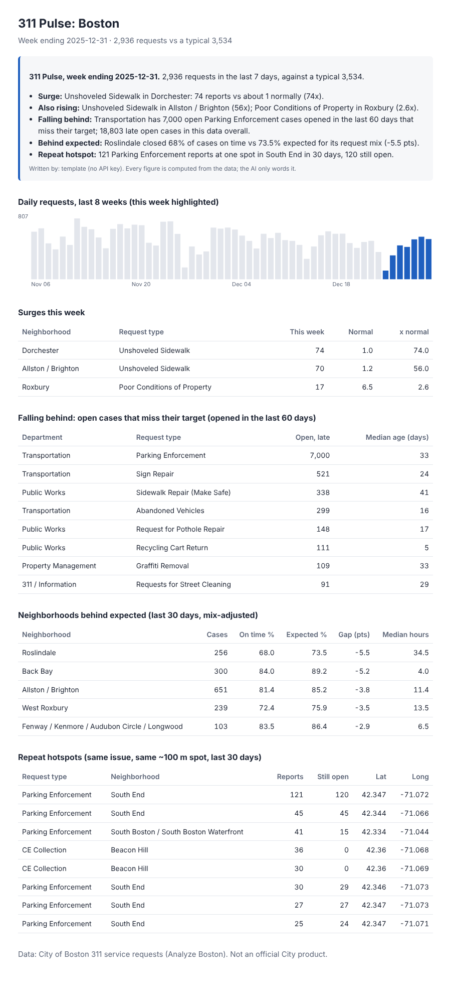

# 311 Pulse: Boston

[](https://github.com/SumanBadakada/boston-311-pulse/actions/workflows/tests.yml)

**A daily-refreshed operations brief for Boston city managers, built from live 311 service requests.** It answers four questions every Monday: *what's surging, who's falling behind, which neighborhoods are being served worse than they should be, and which problems keep coming back.* Each summary is generated from computed findings and includes downloadable evidence.

**Published briefs:** [Daily](https://sumanbadakada.github.io/boston-311-pulse/daily.html) · [Weekly](https://sumanbadakada.github.io/boston-311-pulse/)

**Interactive app: [boston-311-pulse.streamlit.app](https://boston-311-pulse.streamlit.app/)**



## Why

Boston logs hundreds of thousands of 311 requests a year. Dashboards show what happened; a manager starting the week needs to know what to act on. This started as a team Tableau analysis for *Analytics for Managers* at BU Questrom, comparing each neighborhood's on-time rate with what its request mix predicts. 311 Pulse turns that one-off analysis into a tool that runs on any week and says what changed.

## Explore service requests

Search by case number or address and combine filters for issue type, department, neighborhood, opening date, status and overdue status. The map and table use the same filters. Select a case to see available city notes and photos, its timeline and open or recently closed cases nearby. Likely duplicates share an issue type or issue family. Follow-up drafts can go to 311, the district councilor through the City Council inbox, or both.

Daily and weekly briefs use their own reporting windows and the prior four weeks as the volume baseline. Backlog is measured at the end of the selected day. Neighborhood gaps and repeat hotspots use 30-day windows. Open a finding's evidence in the app or download a ZIP from the published brief. Evidence includes case numbers, the observed and baseline rows, and the case-level inputs to the calculation. Older rows in the snapshot cover still-open cases only, up to 180 days.

## For residents: is this already reported?

Upload a photo or describe a problem in a public space:

1. **Gemini reads the photo** and names the issue (pothole, streetlight, graffiti, dumping...), with a one-line description a crew could act on. The resident can always correct it.
2. **Location** comes from the photo's GPS; if the browser stripped it, the resident types an address (geocoded with OpenStreetMap, limited to Boston).
3. **Matching** searches open cases, and cases closed in the last week, of the same kind within 150 m, across both of the City's 311 systems. Request types are grouped in plain language so the legacy "Request for Pothole Repair" and the new system's "Pothole" count as the same thing.
4. **Already reported?** The resident sees the case: when it was opened, its target date, the department, and the case page.
5. **Stalled?** If it's past its target date, the app drafts a follow-up email to 311 (311@boston.gov), copying the City Council for the district's councilor. The resident reviews it and sends it from their own email.
6. **Not found?** A couple of verifying questions and a 400 m search, then a ready-to-paste report and a link to file it on the City's official BOS:311 site.

The app never files a case or sends an email on anyone's behalf, and photos aren't stored.

## For residents: track a case you already reported

Enter a case number in the **Track my case** tab:

- **A plain verdict.** On track, taking longer than usual, or slower than 8 in 10 similar cases, measured against the fix-time prediction below, with a progress bar from the day it was reported.
- **Cases like mine.** Of similar issues reported within three days of yours, the share already fixed, citywide and in your neighborhood.
- **You're not alone.** Other open reports of the same issue within 150 m, which also go into the follow-up email as evidence.
- **The City's closing note.** If the case was closed, what the crew wrote, and a direct path to re-report it if the problem is still there.
- **What to do next.** Wait, check back on a specific date, or follow up, with a calendar reminder (.ics) for the check-back date and the drafted email when a follow-up is warranted.
- **A link that remembers.** The page URL carries the case number (`?case=...`), so a bookmark reopens it.

## Predictions from two years of 311 history

Built from the 2024–2025 dataset (283K resolved cases) and stored in `data/model.json` by `python -m pulse.predict <csv>`.

- **How long a fix usually takes.** Every case card shows "similar cases are usually fixed in X days, and 8 in 10 within Y", plus how often they close by their target date. "Similar" starts narrow (same request type, neighborhood and season) and widens when there are fewer than 30 past cases, and the app says which comparison it used. The escalation email cites this, so a follow-up rests on evidence rather than frustration.
- **Seasonal outlook.** For managers: which issues usually rise over the next four weeks (in late January, potholes typically jump about 65% as freeze-thaw sets in).
- **Department backlog.** Every open case per department, how many are past target, and how old they are.

**How accurate is it?** Built from 2024 alone and tested on 130,398 real 2025 cases:

| Check | Result |
| --- | --- |
| Actual fix times inside the predicted 80% range | 79.8% (target 80%) |
| Typical-time error, median | 0.24 days, vs 0.35 for a single citywide guess |
| Predicted vs actual on-time rate | 85.9% vs 86.7% |
| Slow cases (over 3 days): inside the 80% range | 66.3%, so long fixes are harder to predict |

The method is deliberately simple: empirical quantiles of real past cases, no black box, so every prediction can be explained by the cases behind it.

## What the city brief finds

| Check | How | Example (week ending Dec 31 2025) |
| --- | --- | --- |
| **Surges** | Last 7 days vs the prior 4 weeks for every neighborhood × request type, ranked by a Poisson z-score so 40→120 outranks 2→6 | Unshoveled Sidewalk in Dorchester: 74 reports vs ~1 normally (a snowstorm) |
| **Falling behind** | Cases open on the chosen date that miss their service target, opened in the last 60 days, by department | Transportation: 7,000 late open Parking Enforcement cases |
| **Behind expected** | The team's mix-adjusted gap: on-time rate minus the citywide rate for the same request types, last 30 days | Roslindale: 68.0% on time vs 73.5% expected (−5.5 pts) |
| **Repeat hotspots** | Same request type at the same ~100 m spot, 30 days | 121 Parking Enforcement reports at one South End spot, 120 still open |
| **Data check** | Request types that nearly vanished citywide | Flags types moved to Boston's new 311 system, so a data change isn't read as fewer problems |

## Live data, refreshed every morning

The daily GitHub Actions workflow runs at 11:17 UTC and can also be run manually. It publishes both briefs and evidence archives to GitHub Pages and saves the shared snapshot for Streamlit.

Analyze Boston supplies the legacy and new-system case records. Its timestamps are expressed in Boston local time. New yearly resources are discovered from the city catalog, data is pulled by stable row ID, and the refresh guards against a major drop in recent case coverage. The two public datasets remain the source for case counts and service targets. Open311 timestamps are converted from UTC. Its bounded recent feed adds public photos and updates only for an exact case ID or a unique match on the opening second, address, coordinates and issue type. Cases without matching media show the available city record. Failed or rate-limited calls have bounded retries and respect `Retry-After`. A failed primary refresh keeps the last published snapshot.

Published summaries use the computed figures directly. Optional AI wording for local briefs and app follow-up questions retains the existing number check.

## Run it

```bash
pip install -r requirements.txt

python -m pulse.live                           # pull the last 6 weeks of live data
python -m pulse --data data/live_311.csv.gz --period daily  # latest daily HTML brief
streamlit run app.py                           # requests, resident reporting, and briefs

export GEMINI_API_KEY=...                      # optional, free tier: AI-written brief and Q&A
```

Without a key, photo reporting supports manual issue selection and briefs use the computed summary. `data/sample_311.csv.gz` (68K requests, Sept to Dec 2025, from the course dataset) is the fallback when no live file exists.

## Hosting

- **Daily brief:** GitHub Pages, published by `.github/workflows/daily.yml`.
- **Interactive app:** Streamlit Community Cloud from this repo's `app.py`, with `GEMINI_API_KEY` in the app's Secrets. Follow-up questions are capped per visitor to protect the free quota.

## How it's built

```
pulse/live.py     pulls both live Boston 311 datasets into one schema
pulse/engine.py   surges, overdue, behind-expected, hotspots, data check (pure pandas)
pulse/writer.py   template brief, Claude brief + number check, follow-up Q&A
pulse/report.py   self-contained HTML brief (inline SVG chart, light/dark)
pulse/predict.py  fix-time predictions, on-target rates, seasonal outlook (with holdout evaluation)
pulse/issues.py   photo reading, GPS, geocoding, case matching, escalation email, report prep
pulse/tracker.py  case tracking: verdict, similar cases, nearby reports, next step, reminder
app.py            Streamlit UI: report, track my case, and city brief tabs
tests/            offline tests on synthetic data with known answers
```

Design choices worth noting:
- **"As of" any date.** The data stores today's status, so a case closed after the chosen date is treated as still open on it (close time = open time + resolution hours). Any past week can be replayed exactly as it looked then.
- **Actionable over exhaustive.** Overdue cases older than 60 days are counted but not ranked; a 300-day-old open case is a records question, a 3-week-old one can still be worked.
- **A type with no history is not a surge.** New or renamed request codes are excluded from surges rather than flagged at "∞x normal".

## Data and limits

City of Boston [311 Service Requests](https://data.boston.gov/dataset/311-service-requests). The 2024–2025 sample comes from the cleaned course dataset. `expected_on_time` is the citywide on-time rate for each request type. `on_time_flag` is the city's on-time status for each case, so "falling behind" lists open cases already past target or closed late.

Mapping the new system onto the legacy schema is an approximation: department names are matched by code, finer new-system neighborhoods are folded into legacy groupings, and administrative closures (duplicates, invalid, referred) are detected from the closure reason text.

## Roadmap

- Email the brief every Monday (GitHub Actions)
- Department-level views and week-over-week trend for each flagged item

---

Built by [Suman Somaiah](https://github.com/SumanBadakada), extending a team project from *Analytics for Managers* (BU Questrom), with AI pair-programming (Claude). Not an official City of Boston product. MIT licensed.
